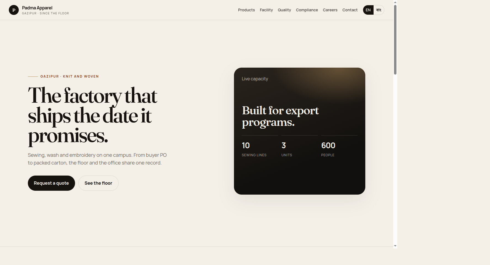
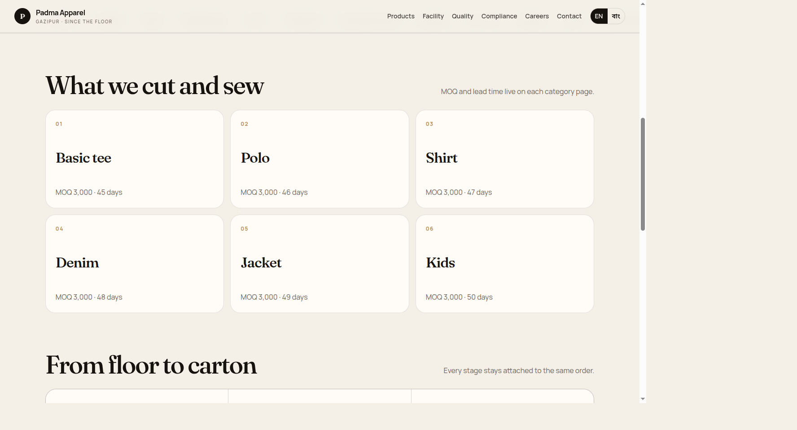
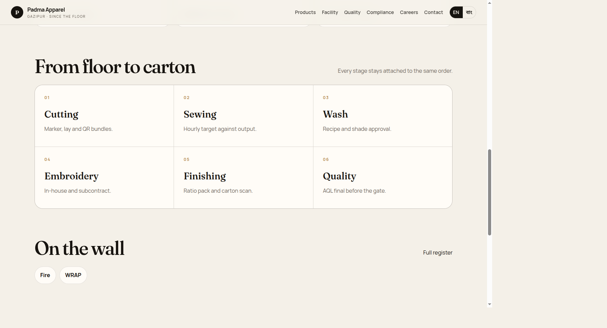
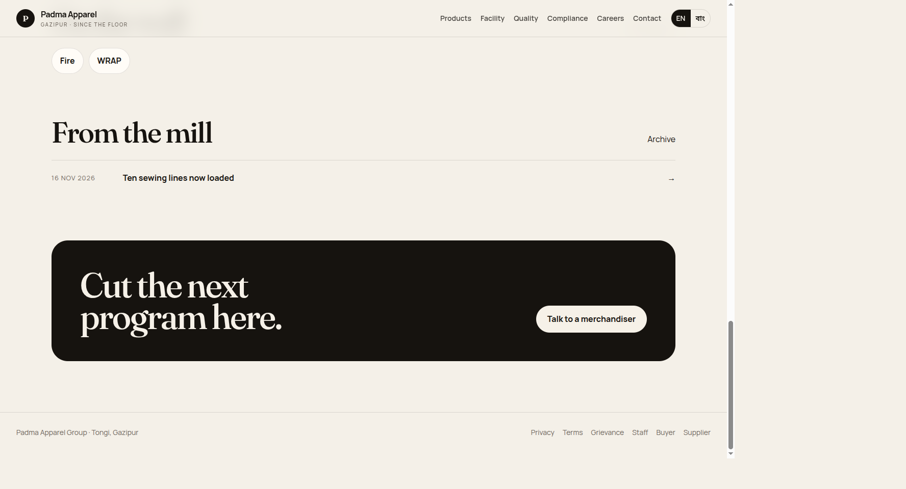
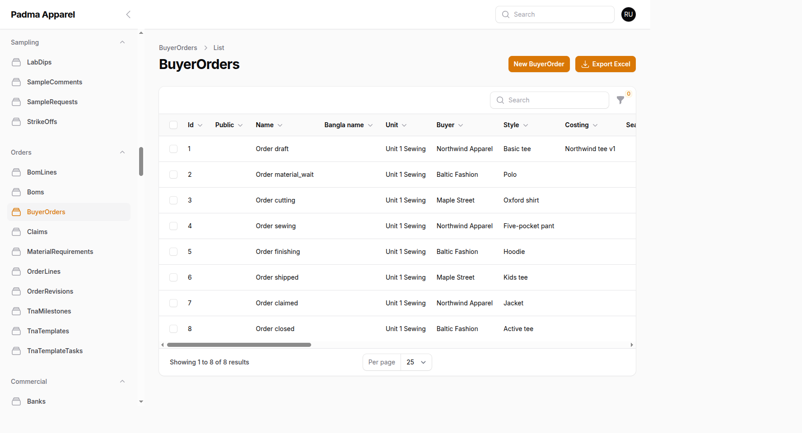
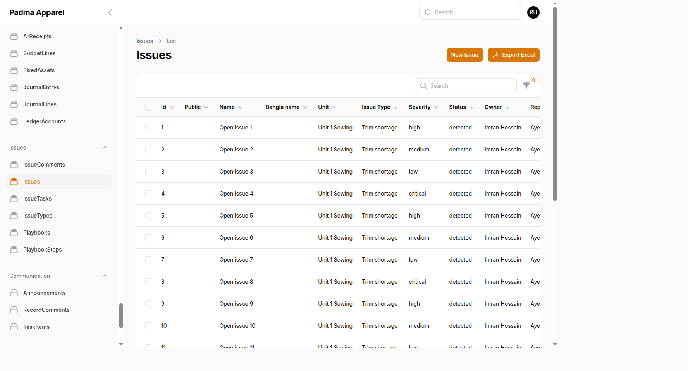

# Padma Apparel

The operating system for a knit and woven export mill. One record follows a program from the buyer’s inquiry to the packed carton, the letter of credit, the wage sheet and the journal.

The public site wins the order. The office, the sewing floor, the buyer, the supplier and the worker each have their own door. English and Bangla. Dates display in Asia/Dhaka and are stored in UTC. Money is stored as integer minor units.



## What a factory gets

- **One program, one record.** Inquiry, quotation, costing, sample, order, BOM, TNA, purchase, fabric roll, cut, sew, wash, embroidery, finish, AQL, carton, shipment, invoice, realization and journal stay attached to the same order.
- **A buyer who can see the date.** The buyer portal shows TNA milestones, inspections, shipments and claims. Status calls become a login.
- **A supplier who can see the PO.** The supplier portal shows purchase orders, goods receipts and invoices.
- **A worker who can see the wage.** The employee portal shows payroll lines, leave, loans, grievances and announcements.
- **A floor that keeps scanning when the network drops.** `/floor-pwa` queues barcode scans in the browser and posts them when the line is back online. The same scan key never inserts a second row.
- **A public front that feeds the office.** A quote request becomes an inquiry. A job application becomes an applicant. A supplier registration and a confidential grievance land in the same database the compliance officer already uses.
- **Exceptions that find their owner.** Overdue TNA, an LC inside 15 days, a certificate inside 30 days, a line below the efficiency line, and stock under its reorder level each open one issue, with an SLA and a playbook.
- **A morning pack that is already written.** At 07:00 Asia/Dhaka the mill gets the report. The issue scan runs every hour. Expiry alerts run at 08:00.
- **Departments you can hide.** Turning a module off removes it from the menu. The rows stay. Turning it back on brings the history with it.
- **A board that can audit the click.** Status changes and edits are written to the audit log. A super admin sees every unit. Everyone else sees their own unit, buyer, supplier or employee record.

## Hours it puts back

These are the hours a 10-line export office (the shape of the demo: about 600 people, several programs in flight) usually spends on this work by spreadsheet, phone and a morning meeting. Padma does the work when a status changes, when the clock hits the schedule, or when someone scans a barcode.

| Work | Usual way | What Padma does | Hours back |
|---|---|---|---|
| Fabric and trim math after a buyer confirms | A merchandiser rebuilds the BOM in a sheet | Confirming the order writes the BOM and the material requirements | 4–6 hours per program |
| Time-and-action calendar | Back-scheduling by hand around Friday and the holiday list | The TNA is built backward from the ship date, using the weekend and the holiday table | 3–4 hours per program |
| Morning exception pack | Store, QC and commercial get called before the meeting | The 07:00 report plus an hourly issue scan | about 1 hour every morning |
| Supplier invoice check | PO, GRN and invoice matched on paper | Three-way match | 20–40 minutes per invoice |
| LC and certificate diary | A weekly spreadsheet | Alerts at 60, 30, 15, 7 and 1 days. An LC inside 15 days also becomes an issue | the weekly diary |
| Wages for ~600 people | A payroll workbook | Payroll from the rules in `config/garment.php`: OT, attendance bonus, festival bonus, max OT | 1–2 days each month |
| Buyer status calls | Phone and email for “where is my order” | Buyer portal for TNA, inspection, shipment and claims | several calls a day |
| Retyping an RFQ email | Copy into a sheet, then into the system | The public form creates the inquiry | about 15 minutes each |

Across a month, that is on the order of **40–70 hours** that leave the spreadsheet and the meeting. A mill running more programs, or more than one unit, gets that saving on every program and every unit.

## Look through it

The public home is the mill’s front door. Categories carry MOQ and lead time. The floor path is the same path the office uses.







The office is the Filament admin panel. The demo already holds eight orders, one for each stage a program actually sits in, and a live issue register for trim shortage.





## Every department

Each module has models, an admin screen (list, create, edit, filters, Excel export, and a workflow action wherever a status exists), a policy, and demo rows on the hero path. PDF download is on the edit screen for orders, BOMs, purchase orders, quotations, commercial invoices, shipments, gate passes, payslips, bundles and cartons.

| Module | What it holds | What it takes off the desk |
|---|---|---|
| Administration | Company, units, floors, lines, roles, permissions, numbering, holidays, shifts, approvals, documents, settings, audit, system health, reports | Number series and an audit trail that does not depend on a shared inbox |
| Master data | Countries, colors, sizes, items, units of measure, defects, incoterms, seasons, brands, HS codes | One item master for costing, purchase and stock |
| Marketing | Buyers, contacts, buying houses, inquiries, quotations, visits, negotiations | The website RFQ lands here as an inquiry |
| Style and costing | Styles, measurements, costing versions and lines | FOB, CM and what-if from `CostingService` |
| Sampling | Sample requests, comments, lab dips, strike-offs | A status path instead of a comment thread |
| Orders | Buyer orders, lines, revisions, BOM, requirements, TNA templates and milestones, claims | Confirm builds BOM, requirements and TNA |
| Commercial | Proforma, LC, amendment, UD, bond, import documents, bill of entry, export bill, invoice, realization, incentive, payment terms, ports, forwarders | LC utilization and margin, plus the expiry clock |
| Procurement | Requisition, RFQ, quotes, purchase order, GRN, supplier invoice, return | Three-way match of PO, receipt and invoice |
| Inventory | Stores, bins, rolls, movements, balances, FIFO layers, reservations, transfers, cycle counts | Receive and issue through `StockService`, with reorder issues |
| Laboratory | 4-point roll inspection, lab tests | Shade and roll decisions on the same order |
| Planning | Line plans and slots | Material readiness on the plan |
| Cutting | Cut plans, markers, lays, bundles | Bundle barcode and a bundle PDF |
| Embroidery | Job work, sent and received quantity | In-house and subcontract on one job |
| Sewing | Line setup, operation bulletin, hourly production, bundle scans, stoppages | Efficiency, the bottleneck, and a low-efficiency issue |
| Quality | Inspections, defects, CAPA, measurement audit, needle log | AQL plans for 1.0, 1.5, 2.5 and 4.0 |
| Wash | Recipes and batches | Recipe and shade approval on the order |
| Finishing | Hourly output, cartons | Ratio pack and carton scan |
| Shipping | Shipments, gate passes, visitors, vehicles | The hero order already has a shipment |
| Maintenance | Machines, work orders, utilities, safety checks | A breakdown has a status path and an owner |
| Human resources | Employees, designations, departments, jobs, applicants, leave, payroll, loans, grievances, training, attendance devices and logs | Payroll from config rules. Careers form feeds applicants. Devices and punches have their own screens |
| Compliance | Certificates, audits, findings, incidents, ESG, chemicals | Expiry alerts, and the public certificate wall |
| Accounts | Ledger, journals, lines, AP, AR, receipts, assets, budgets, banks, fiscal years | Order profit and the hero realization journal |
| Issues | Types, playbooks, steps, issues, tasks, comments | Owned, timed problems. See the path below |
| Communication | Announcements, comments, tasks, notification templates | A log of what was sent |
| Website | Pages, news, categories, FAQs, downloads, contact messages | The public site is edited from here |

The admin panel discovers **182** business screens, plus attendance devices and attendance logs. Floor, buyer, supplier and employee panels are the same records, scoped.

## Five doors, plus the street

| Door | Path | Who it is for |
|---|---|---|
| Office | `/admin` | Merchandising, commercial, store, HR, accounts, compliance, the GM |
| Floor | `/floor` | Rolls, bundles, inspections, cartons, gate passes, hourly production, stoppages, issues |
| Buyer | `/buyer` | That buyer’s TNA, claims, inspections and shipments |
| Supplier | `/supplier` | That supplier’s purchase orders, receipts and invoices |
| Worker | `/me` | That worker’s payroll lines, leave, loans, grievances and announcements |
| Floor scan | `/floor-pwa` | A phone on the line. Works offline, then flushes |
| Operations console | `/console` | The admin package console |
| Public site | `/` | Buyers, applicants, suppliers and the public |

Public pages: home, about, products, facility, machinery, quality, compliance, sustainability, clients, RFQ, careers, news, downloads, contact, FAQ, privacy, terms, code of conduct, grievance, supplier registration, sitemap and robots. The language switch is EN / বাং.

## How an issue gets closed

`detected → assigned → acknowledged → root cause → action plan → in progress → resolved → verified → closed`

A closed issue can be reopened. SLA is 4 hours for critical, 24 for high, 72 for medium, 168 for low. A breach moves the issue back to assigned, writes a comment, and emails the GM. The third issue with the same type and root cause opens one CAPA. The demo playbook for a trim shortage is: check the store, ask an alternate supplier, request buyer approval for a substitute, re-plan the line.

## A program you can open on day one

Northwind’s tee, `PO-DEMO-0001`, is seeded from inquiry through costing, sample approval, confirmation, BOM, TNA, purchase, GRN, fabric roll, stock issue, cutting bundle, QC, carton, shipment, commercial invoice, realization and a posted journal.

The other seven orders sit where a live mill actually is: inquiry, material wait, cutting, sewing, finishing, claimed and closed.

`DEMO_EMPLOYEES` defaults to 600. `DEMO_HISTORY_DAYS` defaults to 30. Tests use 4 employees and 1 day, so the suite stays small.

## What you can turn on

- **Another unit.** A company owns units. A unit owns floors and lines. Transaction tables carry `unit_id`. Users are limited to their units.
- **Another role.** Roles store the panels they may open and the permission keys they grant. `*` is the super-admin grant. `module.{name}` opens a department. `audit.readonly` is the auditor.
- **A hidden department.** `module_settings.enabled = false` removes that group from navigation. Data stays.
- **Bangla.** The public site and the calendar macros (`App\Support\BanglaDate`, on top of Tarikh) speak both languages. The fiscal year runs July–June. The default weekend is Friday.
- **AI, when you want it.** Text, OCR and catalog calls go through `FactoryAi`. With `AI_FEATURES_ENABLED=false` the office still runs, and a person confirms anything extracted from a document before the order is confirmed.
- **A buyer’s own view, a supplier’s own view, a worker’s own view.** Scoping is on the model, so a portal cannot list someone else’s orders.
- **Webhooks.** `POST /api/v1/webhooks` checks `X-Signature` as HMAC-SHA256 of the raw body with `WEBHOOK_SECRET`. A valid call is stored in the notification log.
- **A scan API.** `POST /api/v1/scans` with `Idempotency-Key`. `GET /api/v1/orders`. `POST /api/v1/issues`. Authenticated routes use Sanctum and are limited to 120 requests a minute.

## People

Demo password for every account: `Password@123`.

| Person | Email | Panel |
|---|---|---|
| Rahim Uddin, super admin | super-admin@padma.test | /admin |
| Karim Chowdhury, GM | gm@padma.test | /admin |
| Imran Hossain, merchandiser | merchandiser@padma.test | /admin |
| Ayesha Siddika, line supervisor | line-supervisor@padma.test | /floor |
| Elena Vogel, buyer | buyer@padma.test | /buyer |
| Mill Desk, supplier | supplier@padma.test | /supplier |
| Rina Akter, worker | worker@padma.test | /me |

Every other role follows the same pattern: `{slug}@padma.test`. That includes director, merchandising manager, sample, pattern, commercial, purchase, store, planning, cutting, sewing, line chief, quality, wash, finishing, shipping, maintenance, mechanic, HR, compliance, welfare, accounts, security, IT and auditor.

## Install

```bash
composer install
cp .env.example .env
php artisan key:generate
touch database/database.sqlite
php artisan migrate --force
php artisan db:seed --force
php artisan serve
```

`composer setup` installs dependencies, migrates and builds frontend assets. `composer seed-demo` loads the factory. `composer test` runs Pest.

Then open `/` for the site and `/admin` for the office. Run `php artisan schedule:work` and a queue worker so the morning report, the issue scan, the expiry alerts and the order-confirm plan actually fire. The demo seeder forces the sync queue, so BOM and TNA for the hero order are already there.

## Schedules

| Command | When |
|---|---|
| `garment:morning-report` | 07:00 Asia/Dhaka |
| `garment:scan-issues` | Every hour |
| `garment:expiry-alerts` | 08:00 Asia/Dhaka |

Confirming an order dispatches `OrderConfirmed`. `BuildOrderPlan` then writes the BOM, the material requirements and the TNA.

## Stack

Laravel 12, Filament 3, PHP 8.3+, MySQL or SQLite, Pest, Pint, Larastan. The office is Filament. The public site is Blade.

| Package | What it does here |
|---|---|
| laravel-filament-master | Base resource and the permission key format |
| tarikh | Dates, plus Bangla calendar macros |
| laravel-ai-hub | Optional AI text. Off unless `AI_FEATURES_ENABLED=true` |
| laravel-ai-ocr | Document extraction. Manual when AI is off |
| laravel-ai-catalog | Catalog generation when AI is on |
| laravel-attendance-hub | Devices, punches, and the attendance screens |
| laravel-unicode-pdf | PDF on the ten document types listed above |
| laravel-universal-slug | Slugs for pages, news, products, jobs, case studies and downloads |
| drutogoti | Query and asset watching when `DRUTOGOTI_ENABLED=true` |
| laravel-admin-panel | Operations console at `/console` |

Adhikar is not on Packagist yet. `App\Access\AccessManager` stands in and uses the same permission key format. See `docs/PACKAGE_GAPS.md`.

## Tests

```bash
php artisan test
vendor/bin/pint --test
vendor/bin/phpstan analyse
composer audit
```

## More of the map

- [Architecture](docs/ARCHITECTURE.md)
- [Modules](docs/MODULES.md)
- [Issue engine](docs/ISSUE_ENGINE.md)
- [Automations](docs/AUTOMATIONS.md)
- [API](docs/API.md)
- [Deployment](docs/DEPLOYMENT.md)
- [Decisions](docs/DECISIONS.md)

## 🤝 Let's Connect & Collaborate

I am open to Senior Remote Full-Stack Roles, AI Platform Architecture Contracts, and Enterprise Technical Advisory.

Timezone: UTC+6 (Dhaka / Rangpur, Bangladesh) — Flexible overlap with US, UK, and European business hours.

Delivery Mode: Async-ready, Slack, Discord, Jira, GitHub, and production-first accountability.

| Channel | Address / Handle | Quick Action |
|---|---|---|
| 🌐 Primary Portfolio | imrandev.bd | [Visit Site ↗](https://imrandev.bd) |
| 📦 Packagist Packages | packagist.org/packages/imrandevbd/ | [View Packages ↗](https://packagist.org/packages/imrandevbd/) |
| 💼 LinkedIn Profile | linkedin.com/in/imranbru99 | [Connect ↗](https://www.linkedin.com/in/imranbru99) |
| 🐙 GitHub Profile | github.com/imranbru99 | [Follow ↗](https://github.com/imranbru99) |
| 💬 WhatsApp Direct | +880 1576-918420 | [Chat Now ↗](https://wa.me/8801576918420) |
| 📧 Direct Email | me@imrandev.bd | [Send Email ↗](mailto:me@imrandev.bd) |
| 🐦 X (Twitter) | @imrandev_bd | [Follow ↗](https://x.com/imrandev_bd) |
| 📺 YouTube Tech | @ImranDevBD | [Subscribe ↗](https://www.youtube.com/@ImranDevBD) |
